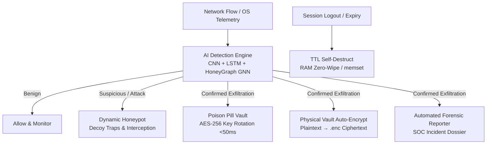

# SHADOWMIND — AN ADAPTIVE CYBER DEFENSE SYSTEM

[](https://github.com/sm-911/Shadowmind/actions/workflows/ci.yml)
[](#overview)
[](#technology-stack)
[](#license)

ShadowMind is an enterprise-grade, zero-trust cybersecurity defense system designed to defeat **low-and-slow data exfiltration** and multi-hop lateral movement attacks. It unifies deep-learning detection, graph-topology analysis, AES-256 cryptographic vault protection, dynamic deception honeypots, and automated forensic reporting into a standalone Windows executable (`ShadowMind.exe`).

---

## Table of Contents

- [Overview](#overview)
- [Novelty & Research Contributions](#novelty--research-contributions)
- [System Architecture](#system-architecture)
- [Key Features & Pillars](#key-features--pillars)
- [Technology Stack](#technology-stack)
- [Project Structure](#project-structure)
- [Installation & Quick Start](#installation--quick-start)
- [Running the Application](#running-the-application)
- [Live Attack Demonstration Guide](#live-attack-demonstration-guide)
- [Attack Simulation Scripts](#attack-simulation-scripts)
- [Testing](#testing)
- [Contributing](#contributing)
- [Contributors](#contributors)
- [License](#license)

---

## Overview

Traditional security tools act as static perimeters — blocking attackers at the door but leaving files and keys vulnerable once an adversary slips inside over months of low-and-slow beaconing.

**ShadowMind** inverts this model into a **self-healing, zero-trust immune system**:

1. **Detects** anomalous spatial, temporal, and graph-topology indicators in real time.
2. **Defends** by instantly auto-encrypting local working folders and rotating AES-256 session keys in RAM in under 50 milliseconds.
3. **Deceives** attackers by redirecting them into a dynamic honeypot sandbox and compiling court-ready forensic incident reports.

---

## Novelty & Research Contributions

ShadowMind addresses key limitations in recent cybersecurity literature by fusing AI detection, topology reasoning, and ephemeral cryptography into a unified automated pipeline. For an exhaustive comparison against all 13 foundational studies from the literature survey, refer to [`docs/academic_novelty.md`](docs/academic_novelty.md).

| Related Literature / Study | Prior Approach & Limitation | ShadowMind's Academic Novelty |
|---|---|---|
| **Ferrag et al. (2020)** *Deep learning for IDS* | Isolated deep-learning models for traffic classification without automated post-breach response. | Pairs the 3-way AI detection engine with an automated **Poison Pill Vault** that re-encrypts assets in <50 ms upon breach. |
| **Caville et al. (2022) & Zhong et al. (2024)** *GNN-based IDS / Anomaly-E* | Graph Neural Networks analyze network-flow topology, but lack active deception or dynamic asset re-encryption. | Combines **HoneyGraph GNN** message passing with a **Dynamic Honeypot** to misdirect attackers while locking real files. |
| **Zhang & Shi (2023)** *ML-based dynamic honeypot* | ML-configured honeypots for attacker diversion, operating independently of encryption enclaves. | Fuses dynamic deception directly with the **Poison Pill Vault** and physical folder auto-encryption. |
| **NIST SP 800-207 (2020)** *Zero Trust Architecture* | Defines ZTA for securing users and resources, lacking real-time AI adaptive response and ephemeral RAM key management. | Implements **TTL Self-Destruct** (RAM zero-wipe) and per-session secure keys, guaranteeing zero persistent key windows. |

---

## System Architecture



---

## Key Features & Pillars

1. **AI Detection Engine** — 3-way neural-network ensemble (Spatial 1D-CNN, Temporal LSTM, PyTorch Geometric HoneyGraph GNN) achieving **99.96 % accuracy** on CICIDS2017 flow data.

   | Metric | Score |
   |--------|-------|
   | Accuracy | `99.96 %` |
   | Precision | `0.9992` |
   | Recall | `1.0000` |
   | F1-Score | `0.9996` |

   **Confusion Matrix:**
   ```
                    Predicted Benign    Predicted Malicious
   Actual Benign           2,369                   2
   Actual Malicious            0               2,381
   ```

2. **Physical Local Storage Vault (`/Vault` folder)** — Automatically creates a physical folder on startup where users work in plaintext; instantly auto-encrypts files into `.enc` ciphertext upon breach detection.

3. **Poison Pill Vault** — AES-256 Fernet encryption with keys held exclusively in RAM. Executes emergency re-encryption in < 50 ms, rendering stolen ciphertext permanently invalid.

4. **Dynamic Honeypot & Threat Intelligence** — Deploys interactive decoy shares (`aws_production_keys.env`, `financial_passwords.xlsx`), logs attacker IP addresses, and profiles infrastructure via geolocation/ASN lookup.

5. **TTL Self-Destruct** — Forcefully zero-wipes decryption keys from RAM (`memset`) upon session expiry or exit.

6. **Automated Forensic Reporting** — Autonomously compiles timestamped SOC incident reports (`Incident_Report_<timestamp>.txt`) upon confirmed intrusion.

7. **Unified Attack Simulation Runner** — Single configurable entry point (`attack_runner.py`) replacing all individual attack scripts, with mode flags (`--mode parallel | serial | multihop`), central YAML config, and full `logging` support.

---

## Technology Stack

| Layer | Technology |
|-------|-----------|
| **Core Runtime** | Python 3.10+ / PyInstaller (`ShadowMind.exe`) |
| **AI / ML** | PyTorch, PyTorch Geometric (GNN), scikit-learn, NumPy, Pandas |
| **Cryptography** | `cryptography` library (AES-256 Fernet CBC + HMAC-SHA256) |
| **Desktop UI** | CustomTkinter (OLED dark cyberpunk glassmorphism) |
| **Network / Telemetry** | Built-in TCP Socket & HTTP Gateway (Port 8080), Cloudflare Tunnels |
| **Testing** | pytest, unittest.mock |
| **CI** | GitHub Actions (flake8, black, pytest on Python 3.10 & 3.11) |
| **Packaging** | pyproject.toml / setuptools |

---

## Project Structure

```
Shadowmind/
├── .github/
│   └── workflows/
│       └── ci.yml               # GitHub Actions CI pipeline
├── configs/
│   ├── attack_config.yaml       # Unified attack runner config (URL, paths, timing)
│   ├── thresholds.yaml          # Tunable system thresholds & TTL params
│   └── thresholds_tuned.yaml    # Production-optimized config
├── docs/
│   ├── academic_novelty.md      # Full 13-study literature-review table
│   ├── accuracy_report.md
│   └── phase_*_report.md        # Phase completion reports
├── notebooks/
│   ├── 01_detection_cnn_lstm_mlp.ipynb
│   └── 02_honeygraph_gnn.ipynb
├── src/
│   ├── auth/                    # Secure authentication & password hashing
│   ├── data/                    # Synthetic generator, preprocessor, graph builder
│   ├── detection/               # CNN, LSTM, GNN, MLP fusion + training script
│   ├── honeypot/                # Decoy manager, interaction logger, redirector
│   ├── intelligence/            # AttackerProfiler & IncidentReporter
│   ├── utils/                   # Path helpers & global settings state
│   ├── vault/                   # AES vault, keygen, rotation, TTL zero-wipe
│   └── workspace/               # External physical Vault folder manager
├── tests/
│   ├── test_attack_runner.py    # Unit tests for unified attack runner
│   ├── test_proxy.py            # Unit tests for proxy relay
│   └── test_integration.py      # End-to-end attack simulation tests
├── ui/
│   ├── tabs/                    # Dashboard, File Vault, Honeypot, Settings tabs
│   ├── widgets/                 # Interactive card-based log viewer
│   ├── animations.py
│   ├── main_window.py
│   └── theme.py
├── website/                     # Vercel cyberpunk landing page
├── attack_runner.py             # Unified attack simulation entry point (NEW)
├── multihop_attack.py           # Multi-hop lateral-movement demo
├── proxy.py                     # Multi-hop proxy relay (Phone 2 / Termux)
├── main.py                      # Application entry point
├── pyproject.toml               # Project packaging & tool config (NEW)
├── Makefile                     # Developer shortcuts (NEW)
├── CONTRIBUTING.md              # Contributor guide (NEW)
├── CONTRIBUTIONS.md             # Branch change summary
└── requirements.txt             # Python dependencies
```

---

## Installation & Quick Start

### Option A — Standalone Executable (Recommended for Demo)

1. Download **`ShadowMind.exe`** from the [GitHub Releases Page](https://github.com/Sourya-Dey05/Shadowmind/releases/tag/v1.0.0).
2. Double-click `ShadowMind.exe` — no Python installation or `pip install` required.

### Option B — Run from Source (Developers)

```bash
# 1. Clone your fork
git clone https://github.com/sm-911/Shadowmind.git
cd Shadowmind

# 2. Create & activate a virtual environment
python -m venv .venv
# Windows:
.venv\Scripts\activate
# Linux / macOS:
source .venv/bin/activate

# 3. Install in editable mode (includes dev extras)
pip install -e ".[dev]"
# OR using the classic requirements file:
pip install -r requirements.txt
```

---

## Running the Application

### 1. Launch

```powershell
# From source
python main.py

# OR double-click ShadowMind.exe
```

### 2. Operator Authentication

| Field | Value |
|-------|-------|
| **Operator Email** | `souryanew@shadowmind.com` |
| **Password** | `Sourya@2026dey` |

### 3. Control Tabs

| Tab | Purpose |
|-----|---------|
| **Dashboard** | Real-time AI threat scoring (CNN + LSTM + HoneyGraph GNN), live threat metrics, event logs. |
| **File Vault & Workspace** | Monitors `/Vault` folder; plaintext files are auto-encrypted to `.enc` on breach. Includes decryption tools and emergency key rotation. |
| **Honeypot** | Active deception traps and live attacker interception intel feeds. |
| **Settings** | Detection-filter mode toggle ("Attack Only" vs "Attack & Benign"), exfiltration breach audit history. |

---

## Live Attack Demonstration Guide

### Single-Device / Cross-Device Ingress

```powershell
# 1. Start ShadowMind
python main.py

# 2. Expose port 8080 via Cloudflare Tunnel
.\cloudflared.exe tunnel --url http://localhost:8080

# 3. Run an attack simulation from another device
python attack_runner.py --mode parallel --url https://<your-tunnel>.trycloudflare.com
```

**Observed Defense:**
- Dashboard turns **Red (`CONFIRMED EXFILTRATION`)**.
- `/Vault` folder auto-encrypts files into `.enc` ciphertext in ~18 ms.
- Honeypot tab records attacker IP, geolocation, and file download attempts.
- Forensic report auto-generated in `data/reports/`.

### Multi-Hop Lateral Movement (HoneyGraph GNN Demo)

```
Device A (Attacker) → Device B (Phone running proxy.py) → Device C (Laptop running ShadowMind)
```

```powershell
# On Phone 2 (Device B) — start the relay proxy
python proxy.py

# On Attacker Laptop (Device A) — launch multi-hop attack
python attack_runner.py --mode multihop --url http://<PHONE2-IP>:9000
```

---

## Attack Simulation Scripts

> All standalone attack scripts are consolidated into the unified **`attack_runner.py`** module.
> The original individual files (`parallel_attack.py`, `serial_attack.py`, etc.) are preserved for reference.

### `attack_runner.py` — Unified Entry Point

```bash
# Parallel (concurrent) attack
python attack_runner.py --mode parallel [--url http://TARGET:8080] [--workers 6] [--native]

# Serial (sequential / low-and-slow) attack
python attack_runner.py --mode serial [--url http://TARGET:8080] [--delay 3.0] [--native]

# Multi-hop lateral-movement demo
python attack_runner.py --mode multihop [--url http://PROXY-IP:9000]

# Using Makefile shortcuts
make demo                        # parallel attack (default local URL)
make demo-url URL=https://...    # parallel attack against custom URL
```

Configure the default target, paths, and timing in [`configs/attack_config.yaml`](configs/attack_config.yaml).

| Script | Mode flag | Description |
|--------|-----------|-------------|
| Parallel (requests) | `--mode parallel` | Concurrent HTTP stress-test via `ThreadPoolExecutor` |
| Parallel (stdlib) | `--mode parallel --native` | Zero-dependency concurrent attack |
| Serial (requests) | `--mode serial` | Low-and-slow sequential probes |
| Serial (stdlib) | `--mode serial --native` | Zero-dependency sequential attack |
| Multi-hop | `--mode multihop` | Lateral-movement via phone proxy |

---

## Testing

```bash
# Run the full test suite
pytest tests/ -v

# Run with coverage
pip install pytest-cov
pytest tests/ --cov=. --cov-report=term-missing

# Run only attack-runner unit tests
pytest tests/test_attack_runner.py -v

# Run CI checks locally
make lint    # flake8
make format  # black --check
make test    # pytest
```

The CI pipeline (`.github/workflows/ci.yml`) automatically runs lint + tests on every push and pull request for Python 3.10 and 3.11.

---

## Contributing

See [`CONTRIBUTING.md`](CONTRIBUTING.md) for the full guide: setup, adding new attack modes, running tests, code style (black + flake8), and PR workflow.

Quick start:

```bash
# Install dev dependencies
pip install -e ".[dev]"

# Format code
make format

# Lint
make lint

# Run tests
make test
```

---

## Contributors

| GitHub Handle | Role | Key Contributions |
|---------------|------|-------------------|
| **[@Sourya-Dey05](https://github.com/Sourya-Dey05)** | Project Lead | Core system architecture, AI detection engine, vault, honeypot, UI, documentation. |
| **[@sm-911](https://github.com/sm-911)** | Contributor | Attack-simulation scripts, proxy enhancements, UI improvements, unified `attack_runner.py`, CI pipeline, test suite, packaging, contributing guide, README rewrite. |

---

## License

Distributed under the MIT License. See `LICENSE` for more information.

---

*Developed as part of Group GRP-45.*
